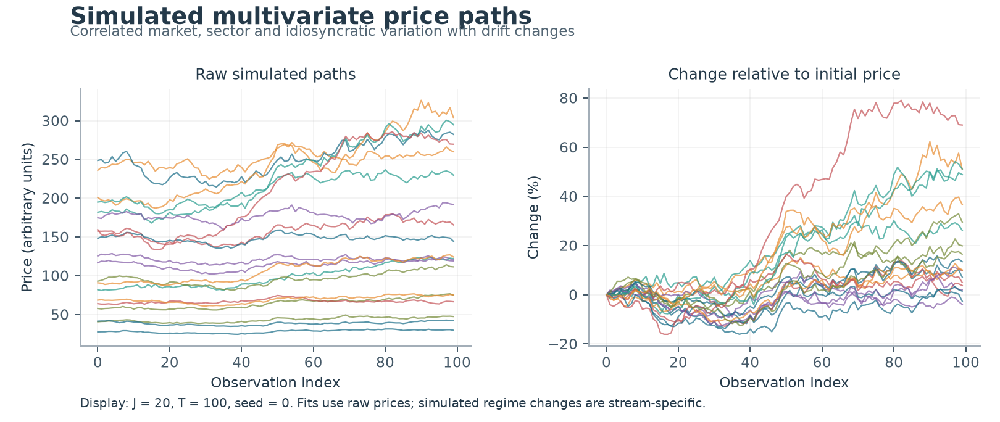
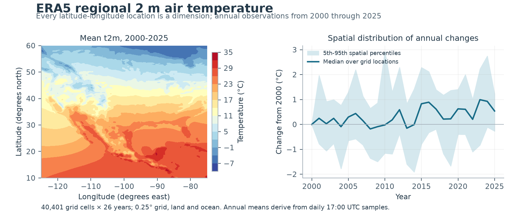
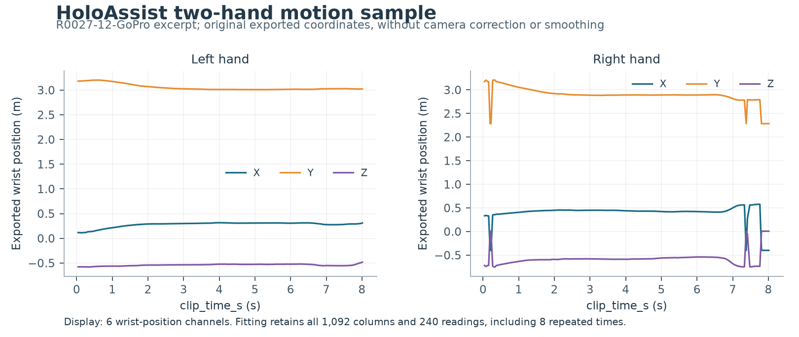
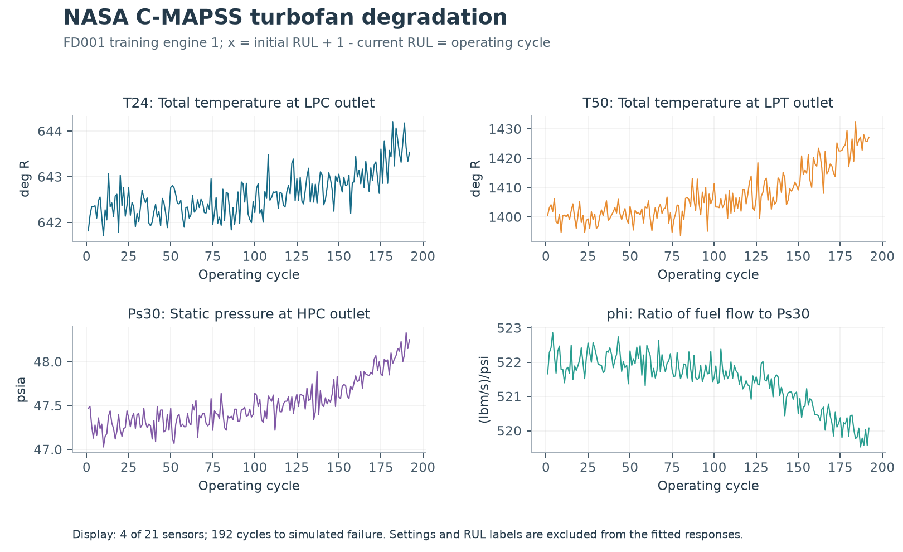

# Shared slope change detection

Reproducible comparisons of **sparse and non-sparse continuous piecewise-linear fitting**: polynomial-time least-squares algorithms alongside a nonconvex mixed-integer benchmark. Every fitted dimension has two continuous linear segments and shares one continuously located breakpoint. Sparse experiments allow slope changes in at most `k = floor(0.20 J)` dimensions.

Companion code for **Polynomial-Time Solvability of the Multi-Dimensional Slope Change Problem**, Apoorva Narula and Santanu S. Dey. See the paper and [solver source files](#code-map) for the polynomial-time methodology. This repository implements the **squared L2/SSE experiments**.

## Run everything

Python **3.11 or 3.12** is recommended. Create/select your virtual environment, then:

```bash
python -m pip install -r requirements.txt
python run_experiments_detailed.py
```

You can also open `run_experiments_detailed.py` in your editor and click **Run Python File** with that environment selected. File paths resolve from the package directory, so running from another working directory works. A working **Gurobi license** is required for the MINLP experiments. Solver/license errors are recorded separately and the exact fits are retained.

The first run downloads three pinned Excel workbooks into `data/raw/` unless already present. Every workbook is checked against [SHA-256 hashes and GitHub commit IDs](data/sources.json). The offline ZIP includes these exact workbooks; source-only downloads acquire them automatically. No API keys or Codex tools are needed.

**Default experiment matrix** (one simulation seed, 0):

| Dataset | Non-sparse J | Sparse J and k | T and x |
|---|---|---|---|
| Simulated | 10, 20, 100, 1,000, 10,000, 100,000 | 10/2, 20/4, 100/20, 1,000/200 | 100; observation indices 0-99 |
| ERA5 t2m | 40,401 | 40,401 / 8,080 | 26; years 2000-2025 inclusive |
| HoloAssist | 1,092 | 1,092 / 218 | 240; original `clip_time_s` |
| NASA C-MAPSS FD001 | 21 | 21 / 4 | 192; training engine 1 operating cycles |

All **16 cases** run the polynomial-time method and attempt the corresponding MINLP on identical raw data. Every MINLP has **TimeLimit = 2,000 seconds**, with no default dimension cap. This is the optimizer limit: construction, bounds and output writing take additional time. A full run can take many hours and substantial memory. The 40,401-dimensional ERA5 sparse run uses the supplied pairwise-crossing method and is particularly demanding. No approximation, temporal subsampling or dimension reduction is silently substituted.

For a short installation check:

```bash
python run_experiments_detailed.py --smoke
```

This tests both methods on J=5, T=10 with **2-second** MINLP limits. It is labeled separately from research results. To run 100 simulation seeds, use `--n-seeds 100`; real datasets still run once each. Use `--help` for dataset selection, thread controls, explicit opt-in MINLP caps and solver logs.

## Datasets at a glance

**Simulation.** [data_simulator.py](data_simulator.py) generates correlated stock-like paths with market, sector and idiosyncratic effects. Its drift-regime changes vary across streams; these are not noiseless signals with one known shared breakpoint. Fitting uses raw prices. The percentage-change panel below is descriptive only.



**ERA5.** [Source and visualizations](https://github.com/ApoorvaGOR/ERA5-Regional-Temperature) · [Annual workbook](https://github.com/ApoorvaGOR/ERA5-Regional-Temperature/blob/main/data/annual/ERA5_Annual_Temperature_1940_2025.xlsx). All 201 × 201 latitude-longitude cells are retained, including ocean cells, over 2000-2025. These t2m values are in °C: equal-month annual averages derived from daily 17:00 UTC samples. They are not full-diurnal annual means. Every location is one dimension.



**HoloAssist.** [Source and visualizations](https://github.com/ApoorvaGOR/HoloAssist-Hand-Sample) · [Workbook](https://github.com/ApoorvaGOR/HoloAssist-Hand-Sample/blob/main/sample/hand_tracking.xlsx). Both hand sheets contribute 546 columns after excluding the specified eight metadata columns. All 1,092 columns remain, including matrix entries, duplicated positions, flags and constants; these are not independent physical sensors. There are 240 readings over the full excerpt, with **eight repeated `clip_time_s` values**. All readings and original timestamps are preserved. See [the methodology audit](docs/METHODOLOGY_CHECK.md#repeated-holoassist-timestamps) for this explicitly documented extension to the distinct-time input assumption.



**NASA C-MAPSS.** [Source and visualizations](https://github.com/ApoorvaGOR/C-MAPSS-Turbofan-Data) · [Workbook](https://github.com/ApoorvaGOR/C-MAPSS-Turbofan-Data/blob/main/data/NASA_FD001_sensor_by_cycle.xlsx). Only **training engine 1** in FD001 is used, with all 21 sensors and all 192 cycles. Operational settings and RUL labels are excluded from Y. Here initial RUL = 191, so `x_i = initial_RUL + 1 - RUL_i = 1,...,192`. Constant sensors are retained. Raw units differ across sensors; unweighted SSE therefore reflects those units.



## MINLP benchmark and comparison

[minlp_benchmark.py](minlp_benchmark.py) implements the manuscript's bounded nonconvex MIQCP/MINLP: binary segment assignments, bilinear continuity, and sparse dimension-selection binaries. Its data-driven slope/intercept bounds and assignment/localization/sparsity Big-M constants follow **Appendix C, (C.1)-(C.25)**. Gurobi uses `NonConvex=2`.

The polynomial-time methods fit unrestricted regression coefficients. The MINLP uses the prescribed parameter box. The runner records whether the particular recovered exact fit lies within that box; inspect this flag before interpreting objective differences as optimization gaps. MINLP bounds and gaps refer to its bounded problem. See [the audit](docs/METHODOLOGY_CHECK.md) for verification, numerical conventions and timing definitions.

## Outputs

Each click creates a separate run under `experiment_results_detailed/runs/<UTC timestamp>/`, preserving the original supplied `experiment_results_detailed` files. Exact results are checkpointed before MINLP optimization; summaries are updated after every case.

| Location within a run | Contents |
|---|---|
| `final_summary.xlsx` | Summary, All replications, MINLP comparison, Configuration |
| `all_replications.csv` | Case-level objectives, breakpoints, runtime components, solver bounds/gaps/statuses and errors |
| `runtime_workbooks/<dataset>/` | One workbook per setting/J; one sheet per seed |
| `detailed_fits/<dataset>/<setting>/J_*/` | Raw data, fitted data, residuals, stream coefficients and summary; default J ≤ 1,100 |
| `fits/<dataset>/<setting>/J_*/` | Complete raw data, all coefficients, supports, interval diagnostics and timings in NPZ, **at every J** |
| `minlp_fits/`, `minlp_logs/` | Incumbent fitted values/coefficients when available; solver logs for every attempted case |
| `minlp_results/` | Machine-readable solver results and process diagnostics; each MINLP runs in a separate process |
| `bounds/` | Actual Appendix C bounds and Big-M arrays for the input instance |
| `datasets/`, `environment.json`, `configuration.json` | Dataset provenance, software/platform metadata and full run configuration |
| `figures/` | Rebuilt descriptive figures, generated outside solver timing |

Reconstruct complete fitted data from an exact NPZ with:

```python
import numpy as np
with np.load("path/to/seed_000000.npz", allow_pickle=False) as d:
    fitted = (d["alpha"][:, None] + d["left_slope"][:, None] * d["x"]
              + d["delta"][:, None] * np.maximum(0, d["x"] - d["shared_breakpoint"]))
    residuals = d["Y"] - fitted
```

For an interrupted run, repeat **the same options**, adding `--resume --output-dir <existing run folder>`. Completed cases are skipped; incomplete/error cases are retried. Close Excel before rerunning if it has locked an output workbook. A hard process or operating-system memory kill can interrupt a large case; already checkpointed results remain.

## Paper figures and validation

The four [PDF figures](figures/) contain vector paths and embedded fonts, with **zero raster images**: [simulation](figures/simulated.pdf), [ERA5](figures/era5.pdf), [HoloAssist](figures/holoassist.pdf), [C-MAPSS](figures/cmapss.pdf). PNGs are README previews. Regenerate with `python make_figures.py`.

```bash
python -m pip install -r requirements-dev.txt
python -m unittest discover -s tests -v
```

Tests compare small problems with exhaustive support enumeration, independent direct least squares and scalar minimization; they also cover ties, repeated times, coefficient recovery and Big-M bounds. [Validation results](validation/README.md) distinguish completed checks from the full 2,000-second experiment matrix. The implemented algorithms follow the exact candidate enumeration methodology using **float64 arithmetic and tolerances**, rather than the paper's symbolic algebraic-number representation.

## Code map

| File | Purpose |
|---|---|
| `run_experiments_detailed.py` | Single entry point for the complete experiment matrix |
| `run_optimization_nonsparse.py` | Supplied non-sparse polynomial-time SSE algorithm |
| `run_optimization_sparse.py` | Supplied sparse polynomial-time SSE algorithm |
| `fitting.py` | Numerically stable coordinate adapter; returns original-unit coefficients |
| `minlp_benchmark.py` | Appendix C bounded Gurobi MINLP benchmark |
| `minlp_worker.py` | Isolated solver process with per-case error reporting |
| `datasets.py`, `data/sources.json` | Strict workbook adapters, pinned downloads and checksums |
| `data_simulator.py` | Supplied simulation generator |
| `reporting.py` | Detailed result workbook formatting |
| `make_figures.py` | Reproducible vector PDF figures |
| `build_release.py` | Source and optional offline ZIP packaging |

Software is covered by the [MIT license](LICENSE). Third-party data retain their source terms and attribution; see [data notices](data/README.md). The software license does not relicense the datasets or the manuscript.

## Acknowledgment of AI-Assisted Development

We acknowledge the use of **OpenAI's ChatGPT and Codex** in assisting with the implementation, debugging, testing, documentation, and organization of the code in this repository.

The **mathematical formulations, theoretical results, polynomial-time algorithms, and underlying optimization methodology** were independently derived and developed by the authors, **Apoorva Narula and Santanu S. Dey**. ChatGPT and Codex were used as software development assistants to translate these mathematical ideas into executable code and facilitate computational experiments.

The authors retain full responsibility for the mathematical correctness, implementation, validation, and reported computational results.
